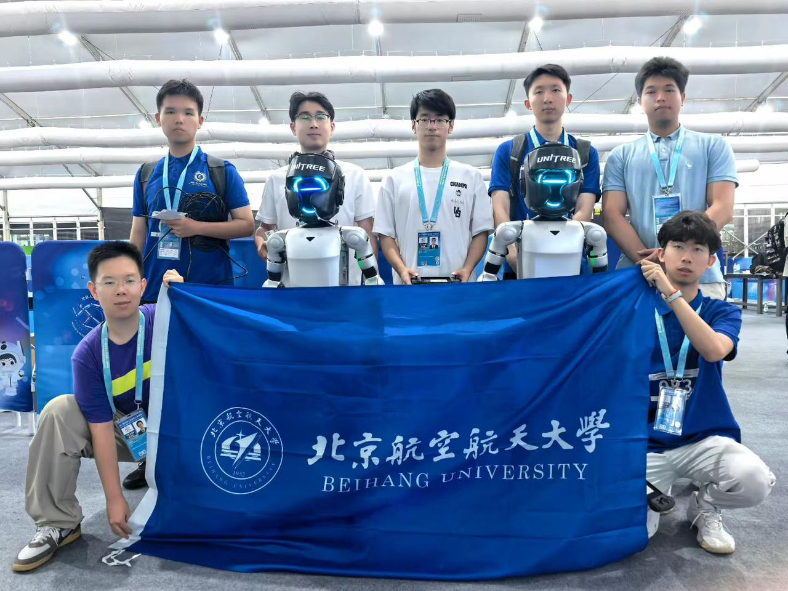
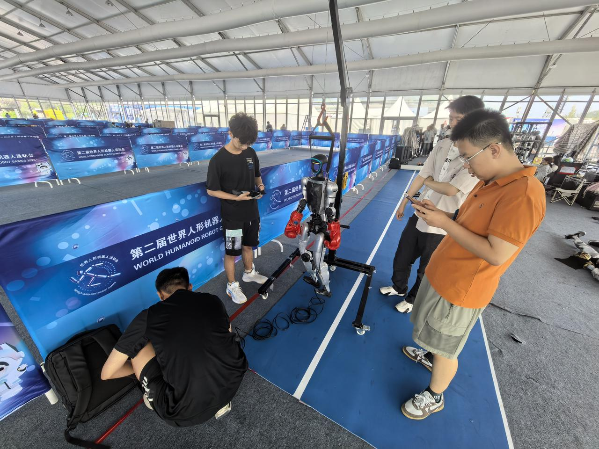
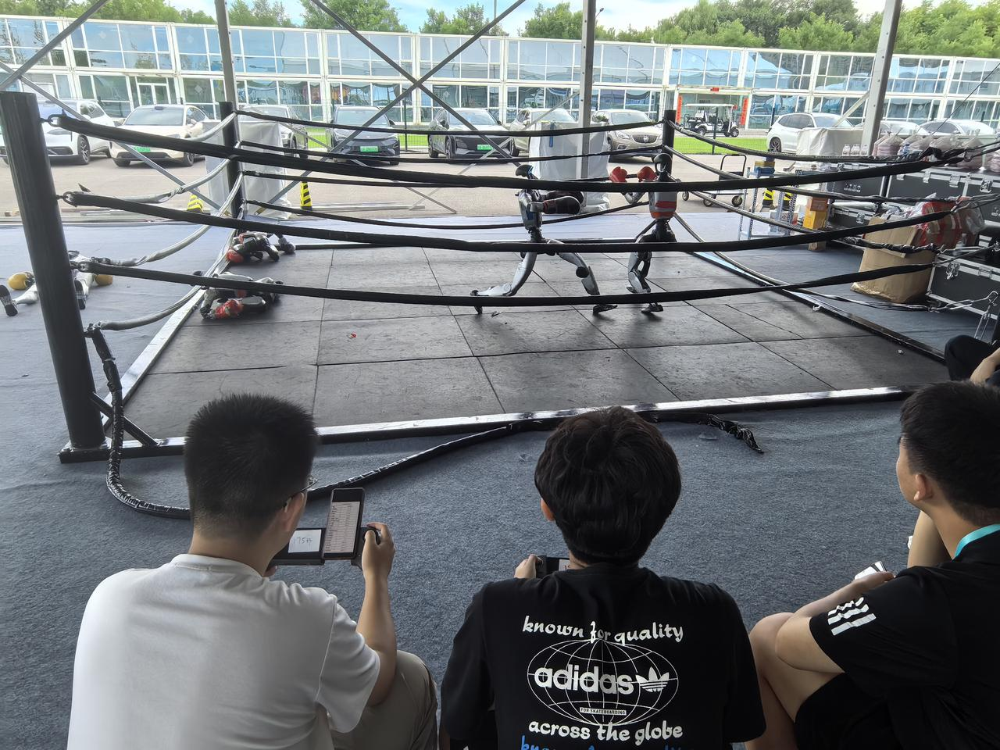
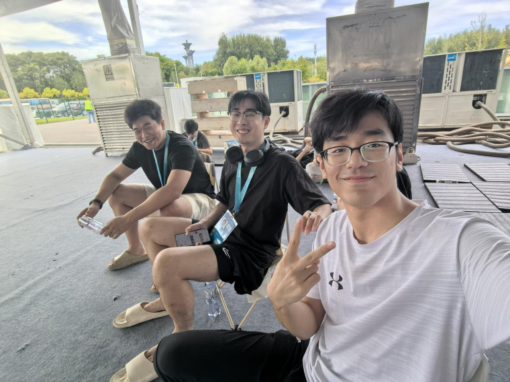
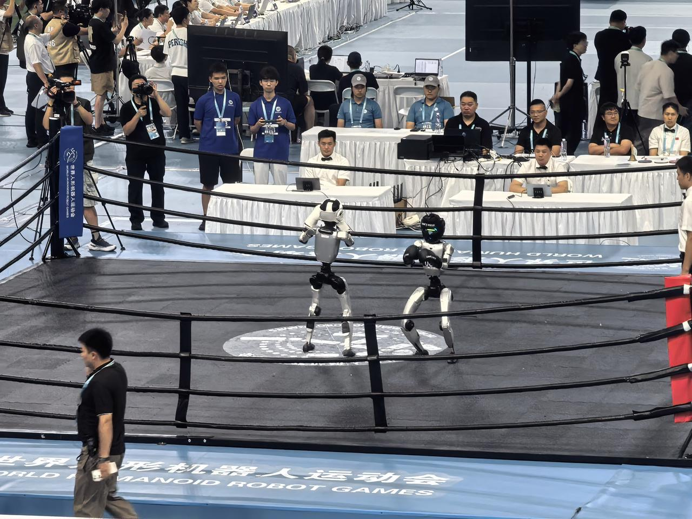
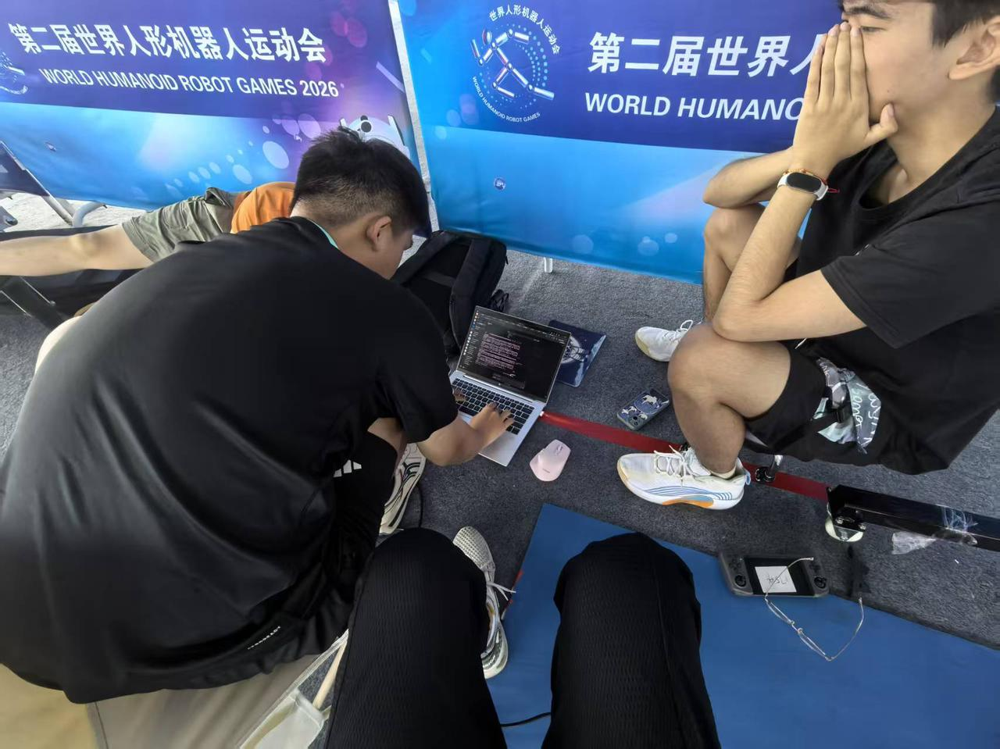
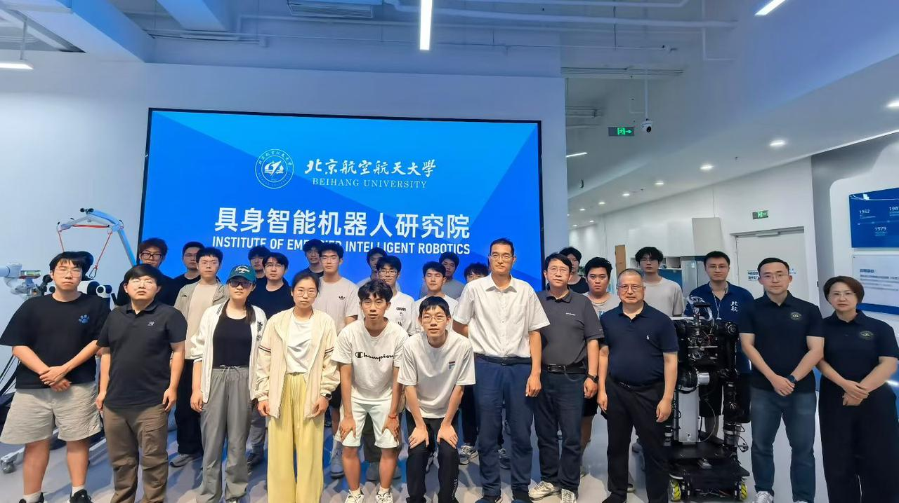

# Motion Control Strategy for WHRG Robotic Free Fighting

北京航空航天大学人形机器人自由搏击运动控制策略仓库。

本项目面向宇树 G1 29DOF 人形机器人，构建了从动作数据处理、强化学习训练、策略导出到仿真和真机部署的完整流程。系统以稳定的 Boxing locomotion 为基础，在同一套有限状态机中组合打拳、左侧踢、右侧踢和回旋踢等高动态序列动作，并在失稳后自动进入恢复策略。

## 项目工作

我们围绕人形机器人自由搏击完成了以下工作：

- 训练能够保持搏击站姿并接受速度指令的 `Boxing` locomotion 策略，实现前后、横向和转向移动。
- 基于 Whole-Body Tracking 训练 `Punch`、`RightKick` 和 `SpinKick` 等全身动作策略，并导出 ONNX 模型和参考 motion 用于部署。
- 建立动作数据裁剪、重采样、插值、速度重算和仿真回放流程，将高质量动作数据转换为训练及部署使用的 NPZ 数据。
- 为 G1 构建统一部署状态机，整合 locomotion、搏击动作、默认站姿、阻尼模式和倒地恢复。
- 实现键盘与手柄控制、速度指令映射、策略关节顺序到硬件顺序映射，以及 x86_64/aarch64 双架构 ONNX Runtime 推理。
- 为序列动作加入相对当前 motion 帧重力方向的失稳检测，动作结束后自动返回 Boxing，倒地后自动进入 Recovery。

## 方法与创新点

### 1. 面向真实接触的仿真外力训练

踢腿是单脚支撑、高动量且伴随接触冲击的动作。仅跟踪无扰动参考轨迹，容易使策略在仿真中表现良好、面对真实接触时却迅速失稳。

我们在部分踢腿动作的训练阶段加入按动作阶段触发的仿真外力或冲量扰动，用来近似击打目标后的反作用力和外部干扰。结合质量、执行器参数等随机化，使策略不仅学习动作轨迹，也学习受力后的姿态调整和支撑恢复，从而提高动作稳定性及真实表现。

### 2. 面向状态切换的动作插帧

高质量动作数据的起止姿态通常与机器人 locomotion 的稳定搏击站姿不完全一致。若直接在两个策略间切换，关节目标、根姿态和速度可能出现突变。

我们利用已有高质量动作数据和 locomotion 策略的稳定站姿，在动作首尾构造过渡并进行插帧，使机器人由稳定站姿平滑进入动作，再平滑回到可继续移动的站姿。位置和关节轨迹使用线性插值，旋转使用四元数球面线性插值，并重新计算线速度、角速度和关节速度。该流程降低了状态切换瞬间的控制冲击，提高了连续执行动作时的稳定性。

### 3. 参考动作感知的倒地检测

踢腿和回旋踢过程中，机体本身会出现明显倾斜。如果始终以固定竖直方向判断倒地，合法的高动态姿态也可能被误判。

对于 `Punch`、`LeftKick`、`RightKick` 和 `SpinKick` 序列动作，部署端比较机器人当前重力方向与当前 motion 帧期望重力方向的夹角。只有相对参考动作的姿态误差持续超过阈值时，才判定失稳并进入 `Recovery`，因此能够区分动作设计中的主动倾斜与真实倒地。

### 4. Locomotion、动作技能与恢复的一体化状态机

系统没有将各策略作为互不相关的演示程序运行，而是把稳定站姿、速度控制、序列动作和倒地恢复组织为完整闭环：

```text
BoxingFixStand
      |
      v
   Boxing  <---------------------------+
      |                                 |
      +--> Punch -----------------------+
      +--> LeftKick --------------------+
      +--> RightKick -------------------+
      +--> SpinKick --------------------+
      |                                 |
      +-- detected fall --> Recovery ---+
```

序列动作播放结束后自动回到 `Boxing`；任何启用倒地检测的策略失稳后进入 `Recovery`；恢复达到直立条件后重新返回 `Boxing`。

## 技术流程

```text
高质量动作数据 + Boxing 稳定站姿
                 |
                 v
       裁剪 / 过渡插帧 / 重采样
                 |
                 v
          NPZ 参考动作与回放验证
                 |
                 v
     Isaac Lab + RSL-RL 策略训练
                 |
                 v
       PyTorch checkpoint / ONNX
                 |
                 v
   sim2sim 验证与部署参数、关节顺序对齐
                 |
                 v
      G1 状态机部署与真机控制
```

## 仓库结构

```text
.
├── training/
│   ├── README.md              # 训练项目索引与目录规范
│   ├── boxing/                # Boxing locomotion 训练
│   ├── punch/                 # 打拳动作训练
│   ├── rightkick/             # 右侧踢动作训练
│   ├── spinkick/              # 回旋踢动作训练
│   └── motion_processing/     # 动作裁剪、插值和验证说明
└── deploy/
    ├── include/               # 通用 FSM、推理和环境组件
    ├── robots/g1/             # G1 控制器、状态实现和配置
    │   └── config/
    │       ├── config.yaml    # 完整状态机配置
    │       └── policy/        # ONNX、motion 与部署参数
    └── thirdparty/            # cnpy 与 ONNX Runtime
```

## 训练项目

每个训练项目在自己的 README 中维护环境安装、训练、回放和模型导出方法。

| 项目 | 训练内容 | 文档 |
|---|---|---|
| Boxing | 搏击站姿下的速度控制与抗扰 locomotion | [training/boxing/README.md](training/boxing/README.md) |
| Punch | 打拳序列动作的 Whole-Body Tracking | [training/punch/README.md](training/punch/README.md) |
| RightKick | 右侧踢序列动作的 Whole-Body Tracking | [training/rightkick/README.md](training/rightkick/README.md) |
| SpinKick | 回旋踢序列动作的 Whole-Body Tracking | [training/spinkick/README.md](training/spinkick/README.md) |
| Motion Processing | 动作裁剪、帧率转换、LERP/SLERP 和回放验证 | [training/motion_processing/README.md](training/motion_processing/README.md) |

训练代码主要基于 Isaac Lab、RSL-RL、PyTorch 和 Gymnasium。各项目的依赖与运行方式存在差异，请以对应子目录中的 README 为准。

## 部署状态

部署状态定义在 [`deploy/robots/g1/config/config.yaml`](deploy/robots/g1/config/config.yaml)。

| ID | 状态 | 功能 | 手柄 | 键盘 |
|---:|---|---|---|---|
| 1 | Passive | 阻尼模式 | `LT+B` | `0` |
| 2 | BoxingFixStand | 搏击站立位姿 | `LT+Up` | `2` |
| 3 | Velocity | 通用 locomotion | `RT+A` | `3` |
| 4 | DefaultFixStand | 官方默认站立位姿 | `LT+Right` | `4` |
| 5 | Boxing | 搏击 locomotion | `RB+A` | `5` |
| 6 | Punch | 打拳序列动作 | `RB+Up` | `6` |
| 7 | LeftKick | 左侧踢序列动作 | `RB+Left` | `7` |
| 8 | Recovery | 倒地恢复 | 自动或 `LT+Down` | `8` |
| 9 | RightKick | 右侧踢序列动作 | `RB+Right` | `9` |
| 10 | SpinKick | 回旋踢序列动作 | `RB+Down` | `K` |

> 文档采用 `LeftKick`、`RightKick` 和 `SpinKick` 作为动作显示名称；配置文件中的状态键分别为 `Leftkick`、`Rightkick` 和 `SpinKick`，路径及名称区分大小写。

### 移动控制

在 locomotion 状态中可以使用键盘模拟手柄摇杆：

| 按键 | 指令 |
|---|---|
| `W` / `S` | 前进 / 后退 |
| `A` / `D` | 左移 / 右移 |
| `Q` / `E` | 左转 / 右转 |
| `Z` | 清零移动指令 |

键盘移动采用 toggle 方式。实际速度范围和加速度限制由当前策略 `deploy.yaml` 中的 `ranges` 与 `max_acceleration` 决定。

## 部署编译

主要依赖：

- Unitree SDK2
- Cyclone DDS C++
- Eigen3
- Boost program_options
- yaml-cpp
- Zlib
- ONNX Runtime 1.22.0

仓库包含 x86_64 和 aarch64 两套 ONNX Runtime 运行库，CMake 会根据目标架构选择对应版本。

```bash
cd deploy/robots/g1
cmake -S . -B build -DCMAKE_BUILD_TYPE=Release
cmake --build build -j4
```

## 运行

仿真：

```bash
cd deploy/robots/g1
./build/g1_ctrl -n lo -c config.yaml
```

真机：

```bash
cd deploy/robots/g1
./build/g1_ctrl -n <network-interface> -c config.yaml
```

`config.yaml` 已是默认配置文件，因此也可以省略 `-c config.yaml`。

## 项目图片与视频

### 图片









### 视频

- [比赛视频 1](competition_video_01.mp4)
- [比赛视频 2](competition_video_02.mp4)
- [比赛视频 3](competition_video_03.mp4)
- [比赛视频 4](competition_video_04.mp4)

## 策略与数据对应关系

部署策略位于 `deploy/robots/g1/config/policy/`。每个策略目录通常包含：

```text
<policy>/
├── exported/policy.onnx      # 推理模型
├── motion/*.npz              # 序列动作参考数据（如适用）
└── params/deploy.yaml        # 观测、动作、增益和关节映射
```

`joint_ids_map` 用于将策略模型关节顺序映射到 Unitree SDK 硬件顺序。更新模型时，需要同步核对 ONNX 输入输出、默认关节位置、刚度/阻尼、动作缩放、观测历史和 motion 关节顺序，不能只替换 `policy.onnx`。

## 安全说明

高动态踢腿、回旋和恢复动作具有较高机械风险。真机运行前应完成 motion 回放、sim2sim、关节顺序和限位检查，并使用保护架、急停和足够的安全空间。首次测试应降低动作强度并由具备机器人操作经验的人员现场监护。
